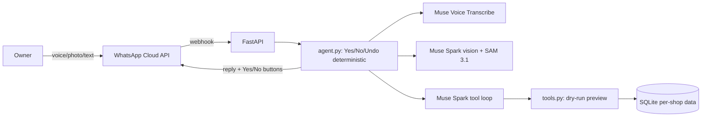

# Sisi — the spaza sister who never forgets

Sisi is a WhatsApp-first assistant for South African spaza shop owners. The owner sends a voice note in her own words ("Sipho took two bread and a 2L Coke on the book"), a photo of a shelf or wholesaler slip, or a short text, and Sisi keeps the credit book (ibhuku), stock and sales, low-stock alerts, a restock list grouped by wholesaler, expiry checks, the daily cash-up, and a compliance helper for registration and the Spaza Shop Support Fund. Every write is shown as a short preview with Yes/No buttons and nothing is saved until the owner confirms; every saved action can be undone.

**The problem.** After the 2024 foodborne-illness deaths linked to spaza shops, every spaza had to register with its municipality (registration closed 28 Feb 2025); of 44,696 verified shops only about 15,000 hold trading permits. The R500 million Spaza Shop Support Fund offers up to R100,000 per shop but is gated by paperwork, and government warns of fake paid "application assistants" — applications are free. Sources: [gov.za media statement, 29 May 2026](https://www.gov.za), [the dtic, 6 Jun 2025](https://www.thedtic.gov.za), [SAnews, 17 Apr 2025](https://www.sanews.gov.za), [spazashopfund.co.za](https://spazashopfund.co.za).

**Built during the hackathon.** Everything in this repo was built during the Meta Global AI Developer Hackathon 2026 (26 Oct – 4 Nov 2026). No earlier code was imported. The git history shows when each feature was built.

## Architecture



## Meta models

| Job | Model | How |
|---|---|---|
| Agent + tool calling + replies | `muse-spark-1.3` (`-contributor` for dev/tests) | Chat Completions, tools, `tool_choice: auto` |
| Vision (expiry, slips, shelves) | `muse-spark-1.3` | base64 data URL + `response_format: json_schema` |
| Voice notes | `muse-voice-transcribe-1.0` | `POST /v1/asr/transcribe`, 16 kHz mono wav via ffmpeg |
| Shelf counting (stretch) | `sam-3.1` | `POST /v1/responses` (streamed) |

## Setup

```bash
python3 -m venv .venv && source .venv/bin/activate
pip install -r requirements.txt
cp .env.example .env   # fill in MODEL_API_KEY, WhatsApp tokens
python -m seed.seed_demo
pytest
```

Run the API: `uvicorn app.main:app --reload`. Local chat (Step 3+): `python cli.py`.

## Try it (judges)

- CLI + seed data: `python -m seed.seed_demo && python cli.py`, shop `27710000001` (MaZulu's Spaza, fictional).
- WhatsApp: message the test number (see hackathon submission) — try "Sipho took two bread and a 2L Coke on the book", tap Yes, then Undo.
- Screenshots: [screenshots/](screenshots/).

## Honest notes

- Muse Voice Transcribe does not officially support isiZulu/Afrikaans. Sisi uses an English language bias plus a keywords list of local brands and slang (Sasko, Albany, Iwisa, ibhuku, skoloto, …) and **always shows the owner what she understood before saving**.
- Token usage is logged per request to `token_usage.log` for spend tracking.
