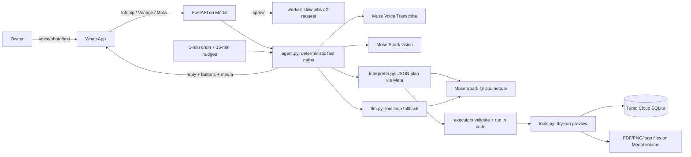
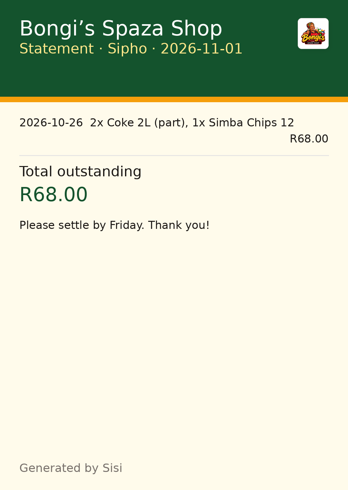
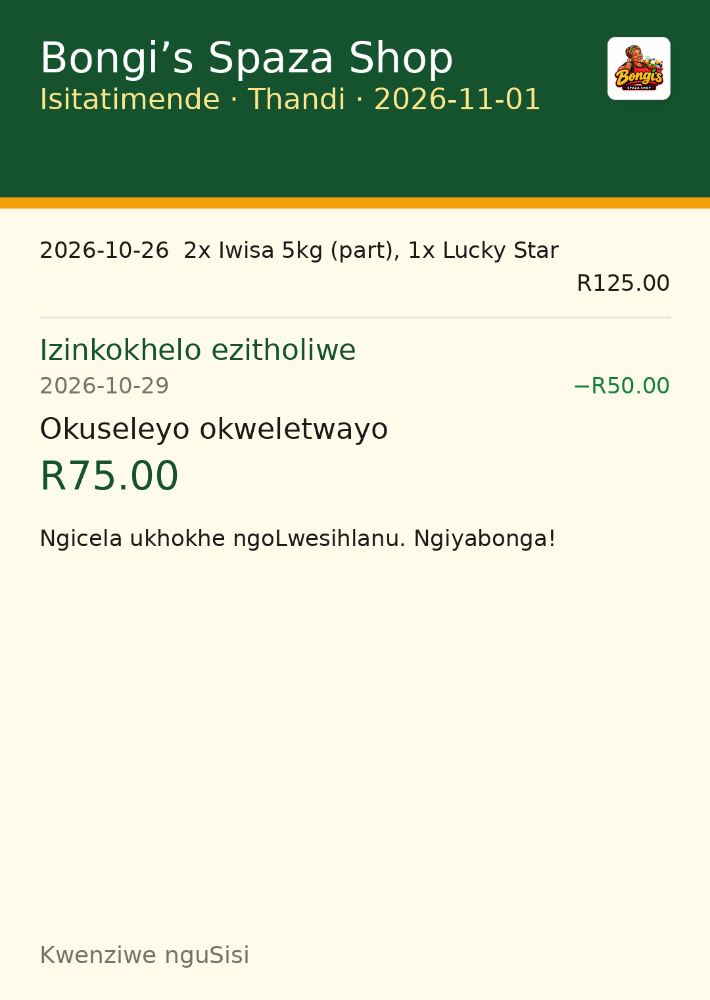
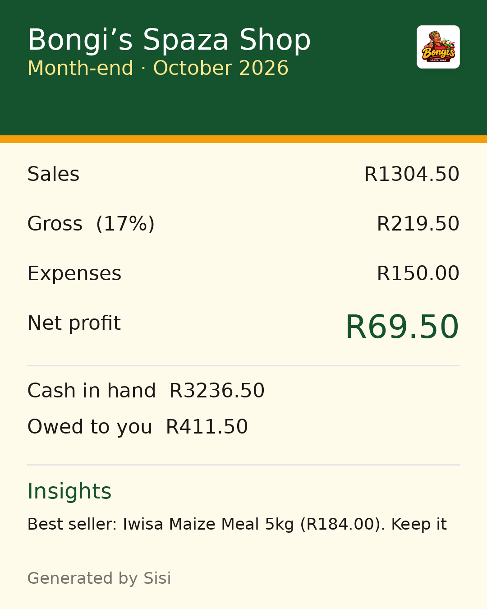
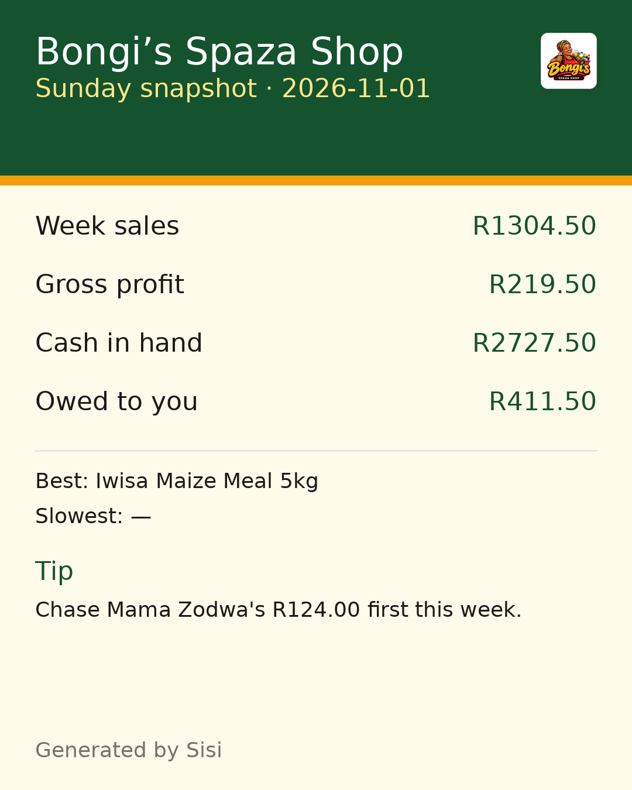
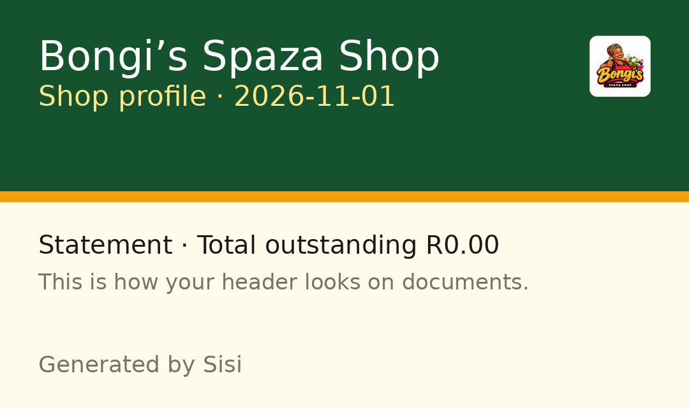

# Sisi — the spaza sister who never forgets

Sisi is a WhatsApp-first assistant for South African spaza shop owners. The owner sends a voice note in her own words ("Sipho took two bread and a 2L Coke on the book"), a photo of a shelf or wholesaler slip, or a short text, and Sisi keeps the books. Every write is shown as a short preview with Yes/No buttons and nothing is saved until the owner confirms; every saved action can be undone.

**Features.** Guided 6-step setup (name, address, contact, logo, float, language) · credit book with limits, overdue flags and reminders · stock and sales in single units out of packs · cash book (till, petty, bank) with float, counts, expenses and drawings · handwritten book-page photos and wholesaler receipt photos with duplicate detection · restock orders with forwardable wholesaler messages · month-end P&L / balance sheet / cash flow as branded PDF + PNG card · customer statements (PNG + PDF) · post-task overview card (one branded shop-standing image + main menu after every saved task) · branded shop logo on every document · staff numbers with permissions · 19:00 book nudge and Sunday snapshot · expiry and price-change alerts · compliance helper for registration and the Spaza Shop Support Fund · credit-readiness funding pack as branded PDF · stock run-out forecasts from sales velocity · full isiZulu, Afrikaans, isiXhosa, Sesotho and Setswana support alongside English.

**The problem.** After the 2024 foodborne-illness deaths linked to spaza shops, every spaza had to register with its municipality (registration closed 28 Feb 2025); of 44,696 verified shops only about 15,000 hold trading permits. The R500 million Spaza Shop Support Fund offers up to R100,000 per shop but is gated by paperwork, and government warns of fake paid "application assistants" — applications are free. Sources: [gov.za media statement, 29 May 2026](https://www.gov.za), [the dtic, 6 Jun 2025](https://www.thedtic.gov.za), [SAnews, 17 Apr 2025](https://www.sanews.gov.za), [spazashopfund.co.za](https://spazashopfund.co.za).
Video stats: ±150,000 spaza shops (UCT Case Writing Centre; Accenture Africa 2023 via Daily Investor), 5.2% of GDP and 2.6 million jobs (UCT via supermarket.co.za).

**Built during the hackathon.** Everything in this repo was built during the Meta Global AI Developer Hackathon 2026 (26 Oct – 4 Nov 2026). No earlier code was imported. The git history shows when each feature was built.

## Architecture (WhatsApp → Modal → Meta models → Turso)



The live channel is Infobip; Vonage and the Meta Cloud API stay as
alternative paths. Webhooks return 200 instantly: each message is handled by
a spawned Modal worker (background task locally), with read receipts,
typing indicators and ⏳ status lines while slow work runs.

Understanding is split: the model reads the full message (transcript,
caption, vision brief, history, open state) and proposes a structured plan;
code validates it and runs each task through the existing tools, so Yes/No,
undo, money math, permissions and duplicate protection never depend on the
model. Exact commands (menus, Yes/No/Undo, reminder management, statements)
stay on deterministic fast paths; multi-intent messages always reach the
planner, and anything the planner declines falls through to a bounded
tool-calling loop. A manual probe script (`scripts/eval_live.py`, fictional
data only) checks planner quality, latency and cost per case, and
`scripts/smoke_demo.py` runs the full end-to-end smoke against production.

## AI models (Meta)

All model calls go to `https://api.meta.ai/v1` with `MODEL_API_KEY`
(OpenAI-SDK compatible). No other model provider is used.

| Job | Model | How |
|---|---|---|
| Understanding + task plans | `muse-spark-1.3` (`-contributor` in dev/prod) | Chat Completions, strict JSON plan schema, `reasoning_effort: low` (env `SISI_REASONING_EFFORT`) |
| Fallback conversation | `muse-spark-1.3` | tool-calling loop, `tool_choice: auto`, max 6 rounds, client-side arg validation |
| Vision (book pages, slips, shelves) | `muse-spark-1.3` | base64 data URL + `response_format: json_schema`, Today context for dates |
| Voice notes | `muse-voice-transcribe-1.0` | `POST /v1/asr/transcribe`, 16 kHz mono wav via ffmpeg, English bias + local brand keywords |

The owner always sees what Sisi understood (transcript, vision lines,
preview with Yes/No) before anything is saved, and every saved action can
be undone.

## Languages

English, isiZulu, Afrikaans, isiXhosa, Sesotho and Setswana throughout:
the message language is detected per message, the owner has a default
language, and each customer can have their own statement language.
Replies, buttons, documents, reminders and the month-end report are all
translated (`app/i18n.py`, enforced by `tests/test_i18n.py`).

## Setup

Prereqs: Python 3.12 and `ffmpeg` (voice notes).

```bash
python3 -m venv .venv && source .venv/bin/activate
pip install -r requirements.txt
cp .env.example .env   # fill in MODEL_API_KEY, WhatsApp tokens
python -m seed.seed_demo   # local demo shop 27710000001 (MaZulu's Spaza, fictional)
pytest                   # full suite, must be green
```

Run the API: `.venv/bin/python -m uvicorn app.main:app --port 8000`.
Local dev uses SQLite (`SISI_DB`, default `data/sisi.db`); set
`TURSO_DATABASE_URL` + `TURSO_AUTH_TOKEN` to use Turso Cloud instead
(production always uses Turso).

## Screenshots

Real documents rendered by Sisi for the demo shop (contact redacted):

| Customer statement (English) | Customer statement (isiZulu) |
|---|---|
|  |  |

| Month-end card | Sunday snapshot | Shop profile |
|---|---|---|
|  |  |  |

## Try it (judges)

- Terminal chat (real model, no WhatsApp): `python -m seed.seed_demo && python -m sisi.chat`, shop `27710000001` (MaZulu's Spaza, fictional).
- Simulated WhatsApp (no Meta account, same webhook + buttons path as production):

  ```bash
  SISI_DB=/tmp/sisi_sim.db .venv/bin/python -m uvicorn app.main:app --port 8000 &
  python scripts/simulate.py "Sipho took 2 Sasko white bread and a 2L Coke on the book"
  python scripts/simulate.py "Yes"
  ```

  Add `APP_SECRET=dev-secret` in front of both commands to also exercise signature verification.
- Voice notes without WhatsApp: `python scripts/simulate.py --audio samples/voice_sipho_credit.ogg`
  sends a local recording through the full voice pipeline (ffmpeg → Muse Voice Transcribe →
  Sisi's reply with the transcript shown first). Needs `ffmpeg` installed and `MODEL_API_KEY` set.
  More samples in [samples/](samples/): cash sale, restock, restock list, cash-up.
- Expiry photo without WhatsApp: `python scripts/simulate.py --photo <shelf.jpg>`
  reads best-before stamps via vision + strict structured output and proposes an
  expiry note. Set `SISI_TODAY=YYYY-MM-DD` on the server to freeze "today" for
  dated props.
- Compliance: `python scripts/simulate.py "Can I get the spaza fund?"` answers
  with the checklist, the official link, and the applications-are-free warning.
- Live WhatsApp: message the demo number **+44 7860 088970** — try "Sipho took two bread and a 2L Coke on the book", tap Yes, then Undo. (Infobip trial sender: verified signup numbers only, ~100 free messages, free-form replies inside the 24h window — see the Infobip section.)
- Screenshots: [screenshots/](screenshots/).

## Reply style guide (standing rule)

Every WhatsApp reply must be visually polished:

- Emoji section headings, WhatsApp *bold* labels, one item per line, a blank
  line between sections. Short sentences, no walls of text.
- Amounts as R0.00. ⚠️ for warnings, ❌ for out of stock, ✅ for confirmations.
- No line over 120 characters; anything over 300 characters has line breaks;
  anything over about 1,500 characters is split at a section boundary
  (`split_message` in `app/whatsapp.py`, applied by both live senders).
- The privacy PS appears only on the first message or in "demo help".
- Buttons before typing: any question with 2–3 short answers is offered as
  tap buttons (with a numbered-text fallback); the owner types or talks only
  when buttons don't make sense.
- The model relays tool results exactly as written (see `REPLY STYLE` in
  `app/prompts.py`). `tests/test_format.py` fails the suite if any
  deterministic reply breaks these rules.

## Go live (no code changes)

Sisi auto-selects the fake sender until both of these are set; add exactly 2 env vars to send via the Cloud API:

```bash
WHATSAPP_TOKEN=...
WHATSAPP_PHONE_NUMBER_ID=...
```

Also set `APP_SECRET` (webhook signature check) and `VERIFY_TOKEN` (webhook verification) before pointing Meta at `/webhook`.

## Deploy (Modal)

Push to `main` deploys automatically: [deploy.yml](.github/workflows/deploy.yml)
runs the full suite on Python 3.12 and, only if green, runs
`modal deploy modal_app.py` and fails unless `/health` returns 200. It
authenticates with repo secrets `MODAL_TOKEN_ID` / `MODAL_TOKEN_SECRET`; app
secrets stay in the Modal secret `sisi-env`, never in GitHub.

Manual deploy does the same three steps:

```bash
./scripts/deploy.sh                             # tests, deploy, health check
```

Or step by step:

```bash
modal setup                                     # once: browser login
modal secret create sisi-env --from-dotenv .env   # once per secret change
modal deploy modal_app.py                       # prints the public URL
```

Paste the printed `https://...modal.run/webhook` URL into the WhatsApp app's
webhook settings (with your `VERIFY_TOKEN`). The app ([modal_app.py](modal_app.py))
runs one warm container with ffmpeg in the image and SQLite on a persistent
`sisi-data` volume. Seed the demo shop remotely after deploy:

```bash
curl -X POST 'https://...modal.run/_admin/seed?token=$VERIFY_TOKEN&shop=27710000001'
```

Rollback: check out the last good commit and `modal deploy modal_app.py` again.

Local alternative: `ngrok http 8000`, then point the webhook at the ngrok URL.

## Vonage sandbox channel (alternative to Meta)

Set `VONAGE_API_KEY`, `VONAGE_API_SECRET` (and optionally `VONAGE_WHATSAPP_FROM`,
default `14157386102`), redeploy, and point the Vonage Messages sandbox at
`https://...modal.run/webhook/vonage` (inbound) and
`https://...modal.run/webhook/vonage/status` (receipts). Vonage messages flow
through the same agent, voice, and vision handlers; replies go back via
Vonage. The Meta `/webhook` path is unchanged.

Hardening in place: signature verification (fails closed when `APP_SECRET` is
set), 256 KB webhook body cap, 30/min per-shop rate limit, retries with backoff
on outbound calls, consent line on first contact, `delete my data` erasure, and
no secrets in code or logs (`pip-audit` clean).

## Infobip WhatsApp channel (alternative provider)

Configure in the Modal secret `sisi-env` (dashboard edit — never replace the
whole secret): `INFOBIP_API_KEY`, `INFOBIP_BASE_URL` (per-account, e.g.
`https://xxx.api.infobip.com`), `INFOBIP_WHATSAPP_FROM` (sender number),
`INFOBIP_WEBHOOK_TOKEN` (generate with
`python -c 'import secrets; print(secrets.token_urlsafe(32))'`). Placeholders
live in `.env.example`; no real values in Git. Redeploy, then in the Infobip
portal go to **Channels and Numbers → WhatsApp → Senders → ⋯ → Edit
configuration → Keywords → Forwarding action → Forward to HTTP** and set the
URL to `https://...modal.run/webhook/infobip/<token>` (inbound); set the
delivery-report URL to `https://...modal.run/webhook/infobip/dlr`. Inbound
auth is the shared path token (constant-time compare, fails closed);
sender mismatch, unknown types, oversize bodies and redeliveries (messageId
dedupe) are dropped safely with instant 200s so Infobip never retries a
receipt. Replies support text, native Yes/No buttons and lists (numbered-text
fallback), images, documents, and read receipts; voice notes and photos flow
through the same transcription and vision handlers.

Trial limits (shared test sender): verified signup numbers only, ~100 free
messages, and free-form replies only inside the 24h user-initiated window —
outside it, only approved templates (`InfobipSender.send_template`, or
`scripts/infobip_probe.py` for the first live send). Live traffic needs a
paying account plus a registered WhatsApp sender; then point
`INFOBIP_WHATSAPP_FROM` at your own number. Set `SISI_PROVIDER=infobip` only
when ready: it locks **all** sends to Infobip and refuses Vonage/Meta sends
instead of silently crossing providers.

Outside-window reminders (templates): Sisi fires due reminders as the
configured template when the 24h window is shut, else holds them as
`blocked` with a visible reason (`my reminders`, `retry reminders`). A
shared sender **cannot** register custom templates (Infobip docs), so on
the trial sender set `SISI_REMINDER_TEMPLATE=test_whatsapp_template_en`
and `SISI_REMINDER_TEMPLATE_LANG=en` in `sisi-env`: that predefined
template has one body placeholder, which is exactly what the reminder
sender fills with the summary (body wording stays Infobip's test text).
With your own sender, register a utility template such as "Your requested
shop reminder: {{1}}" and swap the name. Template parameter counts must
match or Infobip rejects the send; delivery reports arrive at
`/webhook/infobip/dlr` and move reminders to `delivered`/`failed`.

## Honest notes

- Muse Voice Transcribe does not officially support isiZulu/Afrikaans. Sisi uses an English language bias plus a keywords list of local brands and slang (Sasko, Albany, Iwisa, ibhuku, skoloto, …) and **always shows the owner what she understood before saving**.
- Token usage is logged per request to `token_usage.log` for spend tracking.
